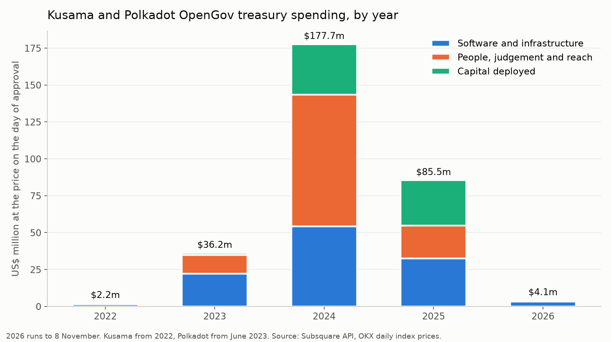
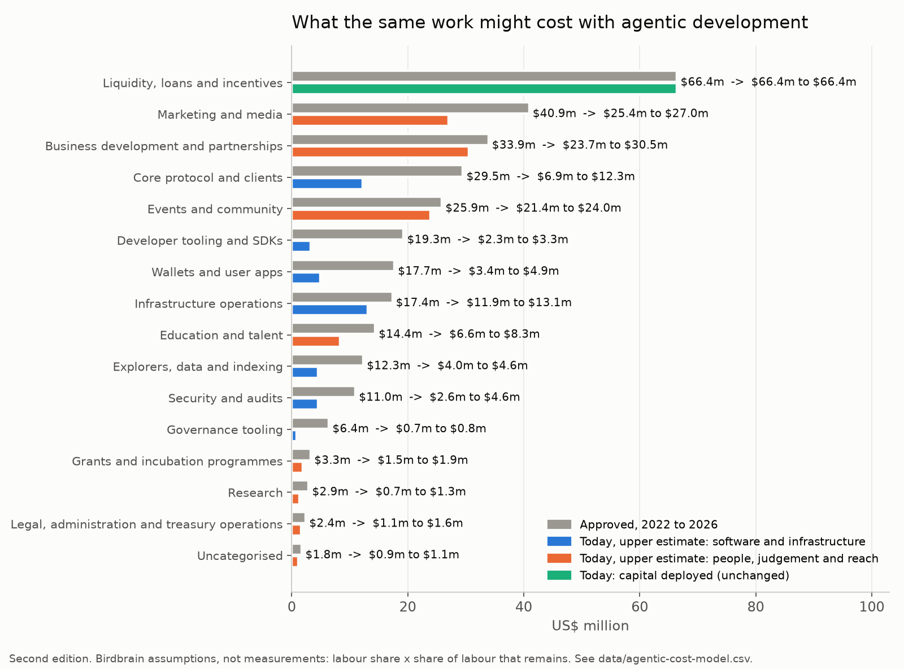

# What Kusama and Polkadot paid to build themselves, and what the same work costs now

Birdbrain · second edition, 8 November 2026 · data to 8 November 2026

Kusama and Polkadot have run their treasuries through OpenGov since late 2022 and mid 2023. Every approved spend is on chain, which makes them two of the best-documented public budgets for building and growing a network. This report totals that spending, prices it in US dollars, and asks a narrower question: if a new network started today and leaned on agentic development, how much of that bill would it still face?

The short answer is that the software bill has collapsed and the rest has not. A small cohort of talented people directing agents can now build and run most of what these treasuries paid companies to build. Most of the money was never software, though. It was choosing what to back, reaching people and deploying capital, and that is the part agents do not make cheaper.

## Summary

1. **US$305.7m approved.** Polkadot US$289.9m (June 2023 to now), Kusama US$15.8m (November 2022 to now), across 965 referenda and 1,337 spend lines, priced in dollars on the day each referendum was enacted.
2. **The DOT and KSM paid out are worth 15% of what they were on the day.** 82% of the money, US$251.6m, was paid in the native tokens. At 8 November 2026 prices (DOT US$0.894, KSM US$3.19) those tokens are worth US$37.8m. Stablecoins went from none of the spending in 2023 to 41% in 2025 and 75% so far in 2026.
3. **Software and infrastructure was 37% of the bill (US$113.7m).** People, judgement and reach (marketing, events, business development, education, grants, research, legal) was 41% (US$125.6m). Capital deployed into liquidity, loans and incentives was 22% (US$66.4m).
4. **On our assumptions, agentic development cuts the software share by 62% to 72%,** to between US$31.8m and US$43.5m. A cohort of 10 to 15 people directing agents for four years lands in the same place, US$33.8m to US$45.9m, and most of that is hardware and bandwidth, not people.
5. **Governance interfaces fall furthest.** We are building one for Kabocha that we expect to take about half an hour of agent time and under US$1 of inference. OpenGov paid US$4.8m for two of them.
6. **The whole bill falls by only 33% to 41%,** to between US$179.5m and US$205.8m, because most of it was not software to begin with.

## 1. What was spent

| Year | Kusama | Polkadot | Combined |
| --- | ---: | ---: | ---: |
| 2022 | US$2.2m | - | US$2.2m |
| 2023 | US$7.1m | US$29.1m | US$36.2m |
| 2024 | US$3.8m | US$173.9m | US$177.7m |
| 2025 | US$2.1m | US$83.4m | US$85.5m |
| 2026 (to 8 Nov) | US$0.7m | US$3.4m | US$4.1m |

Spending followed the token price up and back down. Polkadot's 2024 total is more than the other four years put together. The second quarter of 2024 alone accounts for US$83.7m, including the two Hydration referenda (US$16.8m), the sports sponsorship fund (US$6.8m), Mythical Games (US$6.6m), StellaSwap incentives (US$6.4m), an events bounty top-up (US$5.8m) and two marketing bounty refills (US$7.2m). In 2026 the run rate is a few hundred thousand dollars a month.

| Category | Approved | Share |
| --- | ---: | ---: |
| Liquidity, loans and incentives | US$66.4m | 22% |
| Marketing and media | US$40.9m | 13% |
| Business development and partnerships | US$33.9m | 11% |
| Core protocol and clients | US$29.5m | 10% |
| Events and community | US$25.9m | 8% |
| Developer tooling and SDKs | US$19.3m | 6% |
| Wallets and user apps | US$17.7m | 6% |
| Infrastructure operations | US$17.4m | 6% |
| Education and talent | US$14.4m | 5% |
| Explorers, data and indexing | US$12.3m | 4% |
| Security and audits | US$11.0m | 4% |
| Governance tooling | US$6.4m | 2% |
| Grants and incubation programmes | US$3.3m | 1% |
| Research | US$2.9m | 1% |
| Legal, administration and treasury operations | US$2.4m | 1% |
| Uncategorised | US$1.8m | 1% |

Every line, with its referendum link, is in [`data/spend-lines.csv`](data/spend-lines.csv). One row per referendum is in [`data/referenda.csv`](data/referenda.csv). The same tables are in [`opengov-spending.xlsx`](opengov-spending.xlsx).

## 2. The token problem

A treasury that pays in its own token is paying in something whose value it does not control. Of the US$305.7m approved, US$251.6m went out as DOT or KSM, and those tokens are worth US$37.8m at today's prices. Counting the stablecoin spending too, everything paid out is worth US$91.9m. For Kusama, which paid almost entirely in KSM, the drop is from US$15.8m to US$2.3m.

Two things follow. A supplier paid in DOT or KSM with costs in dollars, pounds or euros has to sell, so a large share of that spending became selling pressure on the asset the treasury holds. And every forecast of runway was a forecast of the token price. The move to stablecoins since 2024 fixes the second problem, not the first. It is a better rule for paying suppliers. It is not, on its own, a way for value to stay in the network.

## 3. What agentic development changes

We split each category into a labour share (the part that paid people to write code, content or analysis) and everything else (hardware, venues, media buys, sponsorships, capital). Then we assume what fraction of that labour a small, experienced team directing coding agents would still need. Cost today is:

> spend × ((1 − labour share) + labour share × labour still needed)

Every input is an assumption, labelled as one in [`data/agentic-cost-model.csv`](data/agentic-cost-model.csv), with the reasoning for each. Change them and the model reruns with `scripts/run.sh`. They are not measurements. The best controlled evidence is still thin: METR's randomised trial found experienced open-source developers 19% slower with early-2025 tools[^metr2025], and its February 2026 follow-up estimated an 18% speed-up for returning developers, with an interval from 38% faster to 9% slower, and called its own signal unreliable because developers withheld the tasks they least wanted to do without AI[^metr2026]. Our settings assume far more than a trial has shown, and this edition is deliberately more aggressive than the first. Those trials measure developers adding agents to their existing way of working. The change we see building with agents every day is different in kind: one person specifies, several agents build and test in parallel, and the person reviews. The gain is largest for well-specified product work against open code, where we now assume 2% to 15% of the old labour remains, and smallest where review and liability set the pace (core protocol and audits, 15% to 35%).

| Group | Approved | Today, low | Today, high |
| --- | ---: | ---: | ---: |
| Software and infrastructure | US$113.7m | US$31.8m | US$43.5m |
| People, judgement and reach | US$125.6m | US$81.3m | US$95.8m |
| Capital deployed | US$66.4m | US$66.4m | US$66.4m |
| **Total** | **US$305.7m** | **US$179.5m** | **US$205.8m** |

The first edition used cautious settings and reached US$204.6m to US$246.4m, with software at US$46.7m to US$68.8m. Both sets are in the repository's history.

### Governance interfaces, built from scratch

Governance tooling is where the change is clearest, so we costed it from the bottom up as well.

OpenGov approved US$6.4m for governance tooling across 26 referenda. Polkassembly received US$2.8m over five referenda and Subsquare, with OpenSquare's related products, US$2.0m over eight. OpenGov.Watch's tracking and reports received US$1.0m. The two main interfaces do largely the same job, side by side, for the same voters. Both publish their code[^pa][^ss], and both serve many chains beyond these two, which these figures do not net off.

A new network needs one governance interface for one chain. Birdbrain is building one for Kabocha now, and we expect a working first version in about half an hour of agent time for under US$1 of inference. That is a first version, not a finished product. Testing it against real referenda, supporting the wallets people use and making it accessible take a few more days of one person's time. After that, the cost is running it, every figure an assumption:

| Item | Year one | Each year after |
| --- | ---: | ---: |
| First working version: about 30 minutes, under US$1 of inference, plus the person's time | under US$200 | - |
| Hardening against real referenda, wallets and accessibility, a few days to two weeks | US$3k to US$10k | - |
| One person deciding what it should show and reviewing changes, 0.1 to 0.2 of their time | US$18k to US$50k | US$18k to US$50k |
| Agent and model spend for upkeep | US$100 to US$1k | US$100 to US$1k |
| Hosting, RPC and indexer on one server | US$3k to US$12k | US$3k to US$12k |
| Moderation and support, part time | US$5k to US$15k | US$5k to US$15k |
| **Total** | **US$29k to US$88k** | **US$26k to US$78k** |

Against about US$1.2m a year for the two main interfaces (US$4.8m over four years), that is a fall of 94% to 98%. The build itself has gone from a funded project to a rounding error: Polkassembly's first OpenGov development grant on Kusama was US$123k[^pa75]. What is left is a person's judgement about what voters need to see, and the server. The factor model above is more cautious (87% to 89%) because it prices the same scope that was bought, including the duplication. The bottom-up figure prices one interface. The difference between the two numbers is a decision about scope, not a technical saving.

The same pattern runs through the rest of the kit a network needs. Polkadot paid US$33.3m in 2024 for governance tooling, explorers and indexing, wallets, developer tooling, infrastructure operations and audits. On our assumptions the same scope costs US$9.0m to US$11.4m today. Wallets show the duplication again: Nova (wallet and Spektr) US$4.4m, SubWallet US$3.4m, Talisman US$2.7m, with smaller amounts to several others.

### The same software bill, as a small cohort

A second way to check the model is to ask what it would cost to put a small team on the whole software scope for the full four years. The inputs are in [`inputs/cohort-assumptions.csv`](inputs/cohort-assumptions.csv) and the result in [`data/cohort-scenario.csv`](data/cohort-scenario.csv).

| Line | Low | High |
| --- | ---: | ---: |
| 10 to 15 senior people, US$180k to US$250k a year each, four years | US$7.2m | US$15.0m |
| Heavy agent use, US$20k to US$60k per person a year | US$0.8m | US$3.6m |
| Independent audits and named reviewers, bought in | US$1.5m | US$3.0m |
| Hardware, bandwidth and other non-labour costs, from the data | US$24.3m | US$24.3m |
| **Total** | **US$33.8m** | **US$45.9m** |

OpenGov approved US$113.7m for software and infrastructure, of which we estimate US$89.4m paid for people's time. A cohort of this size replaces that labour for US$9.5m to US$21.6m. The two methods agree within a few million dollars, and in both the largest remaining line is machines. We think the non-labour figure is itself high, because many of the infrastructure contracts it comes from had operating labour inside them.

A cohort like this is not cheap because the people are cheap. It is cheap because there are few of them. What it cannot do on its own is decide which of the many things it could now build are worth building. That was the scarce input before, hidden inside large teams, and it is the scarce input now.

### What does not get cheaper

Core protocol work moves less than people expect. Most of the protocol was paid for outside OpenGov, by Parity Technologies and the Web3 Foundation, so it is not in these figures. What OpenGov did fund (the Fellowship, Snowbridge, Kagome, Gossamer, storage) is consensus-critical, and its pace is set by review and research rather than typing. Infrastructure operations are mostly hardware and bandwidth. Audits still need someone to sign.

The largest lines are not software at all. US$66.4m went into liquidity, loans and incentives, and US$100.7m into marketing, events and business development. Agents can make the content cheaper. They cannot decide whether a racing sponsorship, a liquidity campaign or a games partnership is worth doing, and that decision is where most of the money went.

## 4. The part that is left is judgement

Put the numbers together and the cost of building a network has fallen a long way, while the cost of deciding what to build has not moved at all. That second cost was always the larger one. It is just easier to see now that the first has shrunk.

OpenGov is a market for proposals. It rewards the ability to write a convincing request and to gather votes, and it pays on approval. It has no native way to price whether a spend kept value in the network after the money left. The record shows what that rule produces: duplicated interfaces, large outlays in a rising market, a treasury paid out mostly in a token that suppliers had to sell, and top-ups when the price fell. None of that needs bad faith to explain it. It is what the rules asked for.

A new network can now get the software for a fraction of what these two paid, from a handful of people. What it still needs is a credible answer to three questions before it spends anything:

1. **What should be built, and what should be left to others?** One governance interface, not two. One explorer contract with a clear service level, not a series of top-ups.
2. **Why this, and how will we know?** A spend should name what it is expected to change and when that will be checked, before the vote.
3. **How does value stay?** Pay suppliers in what their costs are in, and fund things that earn or hold value inside the network: fees, usage, assets the treasury still owns afterwards.

Those are questions of judgement, and they are where the remaining cost of a network sits.

## 5. Caveats

- **Approval, not expense.** We count what OpenGov approved, at the price on the day of enactment. OpenGov.Watch reports expenses as they are paid, so its figures differ: it reports US$133m for Polkadot in 2024[^ogw2024], against our US$173.9m. Bounty funding, liquidity deployments and the Fellowship transfer are counted in full when approved here, and paid out over time there.
- **Not everything was consumed.** Loans (Bifrost, Pendulum) were made to be repaid, liquidity positions may still be held by the treasury, and closed bounties returned unspent funds. We do not net any of these off. The capital line is an upper bound on what was used up.
- **Bounties are counted once.** Funding and top-ups to a bounty count. The bounty's own child payouts do not, to avoid double counting.
- **Exclusions.** 15 lines are excluded because the spend expired, was voided or failed and was re-approved by a later referendum (listed in `inputs/status-overrides.csv`). Spends still scheduled for future payment are included.
- **Two transfers were decoded by hand.** Referendum 832 sent 2,000,000 DOT to the Fellowship treasury and referendum 1783 sent 1,505,000 USDT, both by cross-chain messages the spend parser does not read. They are in `inputs/overrides.csv`.
- **Categories are partly judgement.** We read the titles and summaries of the 320 largest referenda by value (93% of the total) and set their category by hand. The rest are sorted by keyword. Each line says which method set it.
- **Prices.** Daily closing index prices from OKX, saved in `data/raw-prices/`. Stablecoins at US$1.
- **One spend has no price.** Referendum 1077 paid in DED and has no dollar value.
- **Out of scope.** Spending before OpenGov, Parity and Web3 Foundation budgets, parachain treasuries, and the Fellowship's own internal spending.

## 6. Who wrote this and our interest

Birdbrain wrote this. Birdbrain is a network of collectives on Kusama, started by Decent Partners as its public lab, and we build our tools with coding agents. We benefit from the argument that software is cheap and judgement is what costs, so read the model's assumptions with that in mind.

We are also in the data. Decent Partners proposed three Kusama referenda that were enacted: 362 and 471 (Brale's stablecoin integration on Kusama Asset Hub) and 474 (a liquidity subsidy for the KSM/dUSD pool), US$541k between them. Bloque, a company Decent works closely with, proposed 499, 568 and 638, US$338k between them. All six are in the spreadsheet under their own titles.

## Reproducing this

`scripts/run.sh` fetches every referendum from Subsquare's public API, decodes each enacted proposal's calls, prices them, categorises them and rebuilds every file here. `SKIP_FETCH=1` rebuilds from a cached copy. Corrections are welcome as issues or pull requests, especially to categories and to the model's assumptions.

Data and text: CC BY 4.0. Code: MIT.

[^metr2025]: https://arxiv.org/abs/2507.09089
[^metr2026]: https://metr.org/blog/2026-02-24-uplift-update
[^pa]: https://github.com/polkassembly/polkassembly
[^ss]: https://github.com/opensquare-network/subsquare
[^pa75]: https://kusama.subsquare.io/referenda/75
[^ogw2024]: https://forum.polkadot.network/t/2024-polkadot-treasury-report/11658
